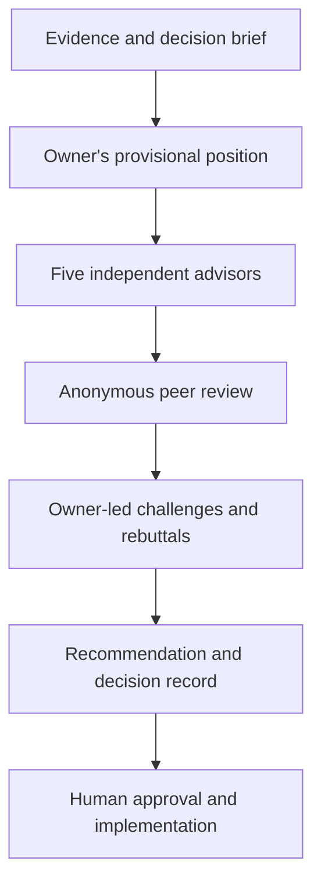

# LLM Council — Software Engineering

An engineering-focused Claude skill for making difficult technical decisions through a structured, evidence-based discussion.

Based on the independent-advisor and anonymous peer-review approach in [Andrej Karpathy's LLM Council](https://github.com/karpathy/llm-council). This fork adapts the workflow to software engineering decisions, with a **Software Architect, Principal/Staff Engineer, or owning Tech Lead** acting as the accountable **Engineering Decision Owner (EDO)**.

## What changed

The original council had five broad business thinking styles and a chairman who summarized the result. This version makes technical decision ownership and real discussion central:

1. **Repository-aware evidence:** read relevant architecture, code, tests, constraints, and existing decisions when available.
2. **Five technical perspectives:** systems architecture, implementation, reliability/security, quality/verification, and a skeptical alternative designer.
3. **An active owner:** the engineering lead takes a provisional position, questions conflicting arguments, hears rebuttals, and explicitly resolves or records dissent.
4. **Anonymous peer review:** proposals are criticized on their evidence, rather than the perceived authority of their author.
5. **Decision-ready result:** a recommended option, trade-offs, tests, rollout/rollback, remaining risks, and an ADR-style record.

The AI provides a **proposed** decision. It never claims to have secured a real engineer's approval or a required Security/SRE/compliance sign-off.

## Who leads?

| Decision type | Default owner |
| --- | --- |
| Cross-service or architectural changes | Software Architect / Principal Engineer |
| Component or service design | Owning Tech Lead / Senior Engineer |
| Implementation and delivery strategy | Engineering Lead |
| Security or production risk exception | Engineering owner, with required specialist approval |
| Product scope and budget | Appropriate product/business owner; engineering provides technical advice |

If your team has a designated human decision owner, include their role in the prompt. The skill can facilitate the discussion but cannot sign off on their behalf.

## When to use

Useful for questions with meaningful trade-offs:

- Should our service use a modular monolith or microservices?
- Should we adopt Kafka or keep synchronous APIs?
- Should we migrate a production database now or incrementally?
- Which caching design meets our consistency and latency requirements?
- Should we refactor a critical module or isolate it behind an adapter?
- Is this authentication architecture safe and maintainable?

Skip the council for straightforward bug fixes, routine coding, factual lookups, and decisions already made.

## Install

The skill instructions live in [SKILL.md](./SKILL.md). Copy that file into the `llm-council` skill directory of your supported Claude Code or Claude Cowork setup, following the skill installation instructions for your environment. The skill name and existing `council this` trigger are retained.

## Use

Try:

```text
engineering council: Should we use a transactional outbox or direct event publishing
for order events? We cannot lose events, and migration must be incremental.
Have the Software Architect own the decision and discuss the risks with all advisors.
```

```text
pressure-test this architecture decision: REST vs gRPC between our internal services.
The owning Tech Lead should make a recommendation based on our existing code,
latency requirements, deployability, and test strategy.
```

```text
run the council on this database migration plan. Identify what evidence is missing,
debate rollback and data consistency, then give me an ADR-style proposed decision.
```

Other triggers: `council this`, `run the council`, `architecture council`, `design review`, `war room this`, `stress-test this`, `debate this`.

## Decision workflow



The owner must resolve or preserve the **actual disagreements**. A simple vote or generic synthesis does not complete the workflow. When sub-agents are not available, the skill discloses that its perspectives are a single-agent analysis rather than claiming independent reviewers.

## Expected output

- Proposed decision and accountable owner role.
- Option comparison grounded in constraints and available evidence.
- Technical arguments, rebuttals, and how the owner resolved them.
- Remaining dissent and risks.
- Acceptance tests, performance/security validation where relevant, delivery and rollback plan.
- Concise ADR-style record and the first action.

## Origins

Originally shared as [Ole Lehmann's Claude LLM Council skill](https://github.com/aiwithremy/claude-skills-llm-council), inspired by [Karpathy's LLM Council](https://github.com/karpathy/llm-council). This repository maintains an engineering-specific adaptation.
